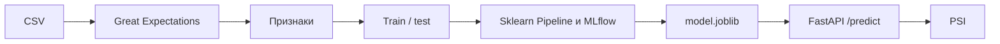

# PD-модель дефолта по кредитной карте

Сквозной пайплайн разработки, проверки, обучения, развертывания и мониторинга модели вероятности дефолта (PD). Учебный проект по дисциплине «Автоматизация процессов разработки и тестирования моделей машинного обучения».

Домен - кредитный скоринг. Данные - [Default of Credit Card Clients](https://www.kaggle.com/datasets/uciml/default-of-credit-card-clients-dataset?spm=a2ty_o01.29997173.0.0.532fc921UIOjfa) (30 000 клиентов, Тайвань). Целевая переменная `default.payment.next.month`: 1 - дефолт в следующем месяце, 0 - нет. В коде она приведена к имени `default_payment_next_month`.

Доля дефолта около 22%, поэтому для сравнения моделей основной метрикой выбран ROC-AUC, а precision / recall / F1 считаются на отложенном тесте при пороге 0.5.



## Структура

```text
src/credit_default/     пакет: данные, валидация, обучение, API, мониторинг
tests/                  unit-тесты pytest и выборка для CI
data/raw                исходный CSV, версия через DVC
data/processed          train.csv и test.csv, версия через DVC
models/                 выбранная модель, версия через DVC
notebooks/01_eda.ipynb  разведочный анализ
reports/                метрики, ROC, матрица ошибок, отчет по дрифту
dvc.yaml                стадии download, prepare, train
.github/workflows/ci-cd.yml  black, flake8, pytest, Great Expectations
```

## Подготовка окружения

Нужен Python 3.11.

```bash
python3.11 -m venv .venv
source .venv/bin/activate
pip install -r requirements-dev.txt
pip install -e .
```

Датасет берется из официального архива UCI (xls внутри zip) и сохраняется как CSV. Если файл `UCI_Credit_Card.csv` уже лежит в `data/raw` или на уровень выше репозитория (`../UCI_Credit_Card.csv`), скрипт использует его и в сеть не ходит.

`pip install -e .` ставит пакет `credit_default` в окружение. Без этого шага команды `python -m credit_default...` не находят модуль: код лежит в `src/`. Цели `make` и стадии DVC сами выставляют `PYTHONPATH=src`, поэтому им установка пакета не обязательна.

```bash
make prepare
make eda
make train
```

`make train` проводит шесть экспериментов, пишет их в MLflow и сохраняет модель с лучшим ROC-AUC на кросс-валидации в `models/model.joblib`.

## Данные и признаки

Сырые поля: лимит, пол, образование, семейное положение, возраст, статусы платежей `PAY_0`…`PAY_6` (в исходном датасете нет `PAY_1`), суммы счетов и платежей за шесть месяцев.

Очистка перед обучением:

- редкие коды образования `0, 4, 5, 6` собираются в «прочее» (`4`);
- код брака `0` собирается в «прочее» (`3`).

Новые признаки:

- `age_bin` - бины возраста: до 25, 25–34, 35–44, 45–54, 55+;
- среднее и максимум статуса платежа, число просрочек (`PAY > 0`);
- среднее и разброс сумм счетов, средний платеж;
- утилизация лимита `BILL_AMT1 / LIMIT_BAL`;
- доля платежа к предыдущему счету;
- изменение счета `BILL_AMT1 - BILL_AMT6`.

Sklearn `Pipeline` внутри обучения делает медиану и `StandardScaler` для числовых полей и моду для категорий с `OneHotEncoder(handle_unknown="ignore")`.

Разбиение стратифицированное, 80/20, `random_state=42` (`params.yaml`).

## Валидация Great Expectations

Правила живут в `src/credit_default/validation/suite.py` (suite `credit_card_raw_suite`). Проверяются обязательные колонки, пропуски, допустимые коды пола, образования и брака, диапазоны возраста, лимита, статусов платежа, счетов и сумм платежей, а также целевая метка `{0, 1}`.

Проверка файла:

```bash
PYTHONPATH=src python -m credit_default.validation.suite --data tests/fixtures/credit_sample.csv
```

Ожидаемая строка: `Валидация пройдена`.

Тест `tests/test_validation.py` падает, если в батче появляются пропуски, возраст вне диапазона или целевая метка вне `{0, 1}`. Тот же шаг есть в GitHub Actions.

## Модель и MLflow

Каждый прогон - отдельный run в эксперименте `credit_default_pd`:

| Эксперимент | Что меняется |
| --- | --- |
| `logreg_baseline` | логистическая регрессия, `C=1` |
| `logreg_balanced` | `C=0.5`, `class_weight=balanced` |
| `logreg_gridsearch` | `GridSearchCV` по `C` и `class_weight` |
| `random_forest` | лес, глубина 8, балансировка классов |
| `gradient_boosting` | бустинг, 100 деревьев, `learning_rate=0.08` |
| `hist_gradient_boosting` | гистограммный бустинг, `class_weight=balanced` |

В MLflow пишутся параметры, ROC-AUC / precision / recall / F1, ROC-кривая и сама модель (`mlflow.sklearn.log_model`). Модель сервиса выбирается по среднему ROC-AUC трех фолдов, тест в выбор не участвует.

```bash
mlflow ui --backend-store-uri "sqlite:///$(pwd)/mlflow.db"
```

В MLflow 3 файловое хранилище `mlruns` по умолчанию выключено, поэтому трекинг пишется в `mlflow.db`, а графики и модели - в `mlartifacts/`. Оба каталога не коммитятся. Интерфейс откроется на http://127.0.0.1:5000. Сравнение прогонов - в `reports/EXPERIMENTS.md` и `reports/metrics.json`. ROC выбранной модели - `reports/figures/roc_curve.png`.

## DVC

Три стадии в `dvc.yaml`:

1. `download` - положить исходный CSV в `data/raw`;
2. `prepare` - валидация, признаки, `train.csv` и `test.csv`;
3. `train` - эксперименты и `models/model.joblib`.

Метрики и таблица экспериментов (`reports/metrics.json`, `reports/experiments.csv`) остаются в Git (`cache: false`). Сырые данные, выборки и модель уходят в кэш DVC.

```bash
dvc repro
dvc push
```

Запускайте это из активированного окружения: в `dvc.yaml` указан `python`, и он должен видеть зависимости проекта. Удаленное хранилище по умолчанию - локальный каталог `storage/` (remote `localstore` в `.dvc/config`). В Git он не входит.

## Тесты и CI

```bash
make lint
make test
```

GitHub Actions (`.github/workflows/ci-cd.yml`, в интерфейсе имя `CI/CD`) на push и pull request:

- `black --check`;
- `flake8`;
- `pytest`;
- валидация `tests/fixtures/credit_sample.csv` через Great Expectations.

Полный датасет в CI не нужен: фикстура из 300 строк проверяет контракт сырых данных.

## API и Docker

`POST /predict` принимает JSON со всеми сырыми признаками клиента и возвращает `prediction` (0 или 1) и `probability`. `POST /predict-batch` принимает до 1000 таких записей и нужен мониторингу. `GET /health` показывает, загружена ли модель. Корневого `GET /` нет, запрос туда отвечает 404.

Локально, в двух терминалах:

```bash
make api
```

```bash
curl http://127.0.0.1:8000/health
curl -X POST http://127.0.0.1:8000/predict \
  -H 'Content-Type: application/json' \
  -d @scripts/sample_request.json
```

Для `scripts/sample_request.json` ответ - класс `1` и вероятность около `0.77`.

Образ содержит зависимости и для обучения, и для инференса. Веса копируются в образ, поэтому сначала нужен `make train`.

```bash
bash scripts/build_and_run.sh
```

Скрипт собирает образ `credit-default-pd`, поднимает контейнер на порту 8000 и вызывает `/health` и `/predict`.

Обучение внутри контейнера, если данные смонтированы:

```bash
docker run --rm \
  -v "$PWD/data:/app/data" \
  -v "$PWD/models:/app/models" \
  -v "$PWD/reports:/app/reports" \
  -v "$PWD/mlartifacts:/app/mlartifacts" \
  -v "$PWD/mlflow.db:/app/mlflow.db" \
  credit-default-pd \
  python -m credit_default.models.train
```

## Мониторинг дрифта

`credit_default.monitoring.simulate` берет часть теста, отправляет ее на API и считает PSI вероятностей и ключевых признаков (`LIMIT_BAL`, `AGE`, утилизация, число просрочек, средний статус платежа) относительно train.

Ориентиры: PSI < 0.1 - стабильно, 0.1–0.25 - умеренный сдвиг, выше 0.25 - существенный сдвиг.

```bash
make api   # в другом терминале, либо уже запущенный Docker
make drift
PYTHONPATH=src python -m credit_default.monitoring.simulate --inject-drift
```

`--inject-drift` искусственно сдвигает лимит, возраст, статус `PAY_0` и утилизацию, чтобы было видно, что PSI реагирует. Отчеты: `reports/drift_report.json` и `reports/drift_report_shifted.json`.

На случайных 500 клиентах из теста PSI вероятностей равен 0.014, признаки тоже ниже 0.03 - сдвига нет. После искусственного сдвига тот же скрипт дает PSI вероятностей 6.62 и переводит все отслеживаемые признаки в полосу `shift`.

## Демонстрация

1. Структура репозитория и `dvc.yaml`.
2. `dvc repro` - download, prepare, train.
3. `reports/metrics.json`, ROC-кривая и матрица ошибок.
4. `mlflow ui` - параметры, метрики и артефакт модели по шести run.
5. `pytest` и workflow `.github/workflows/ci-cd.yml`.
6. `bash scripts/build_and_run.sh` и ответ `/predict`.
7. PSI на обычной тестовой подвыборке и на сдвинутой (`--inject-drift`).

## Результаты

Обучающая выборка - 24 000 клиентов, тест - 6 000. Доля дефолта в обеих частях 0.221. Пропусков в сырых полях нет.

Модель сервиса - `gradient_boosting` (100 деревьев, `learning_rate=0.08`, `max_depth=3`). Она выбрана по CV ROC-AUC, тест в выборе не участвовал.

| Эксперимент | CV ROC-AUC | Test ROC-AUC | Precision | Recall | F1 |
| --- | ---: | ---: | ---: | ---: | ---: |
| gradient_boosting | 0.7864 | 0.7823 | 0.6648 | 0.3662 | 0.4723 |
| hist_gradient_boosting | 0.7859 | 0.7820 | 0.4626 | 0.6240 | 0.5313 |
| random_forest | 0.7853 | 0.7780 | 0.4686 | 0.6119 | 0.5307 |
| logreg_gridsearch | 0.7603 | 0.7472 | 0.4393 | 0.6021 | 0.5079 |
| logreg_balanced | 0.7603 | 0.7472 | 0.4395 | 0.6021 | 0.5081 |
| logreg_baseline | 0.7589 | 0.7448 | 0.6443 | 0.2962 | 0.4058 |

Что из этого следует:

- Деревья обходят логистическую регрессию примерно на 0.025 ROC-AUC. Линейной границы по сырым признакам не хватает: риск сильнее завязан на недавнюю просрочку, чем на гладкую комбинацию всех полей.
- `GridSearchCV` по `C` и `class_weight` выбрал `C=3` и `class_weight=balanced`. Выигрыш у фиксированной balanced-регрессии с `C=0.5` - в четвертом знаке AUC. Сетка здесь полезна как проверка, а не как источник новой модели.
- При пороге 0.5 бустинг без балансировки весов осторожен: precision 0.66, recall 0.37. Сбалансированные лес и гистограммный бустинг ловят около 61–62% дефолтов ценой precision около 0.46 и получают более высокий F1.
- Для ранжирования заявок оставлен градиентный бустинг: у него лучший и CV, и тестовый ROC-AUC (0.782). Если банку нужен именно recall при пороге 0.5, рабочая точка - `hist_gradient_boosting` или сдвиг порога у выбранной модели. Порог на тесте не подбирался.

Графики: `reports/figures/roc_curve.png`, `reports/figures/confusion_matrix.png`, `reports/figures/feature_importance.png`. Разбор данных - в `notebooks/01_eda.ipynb`.
